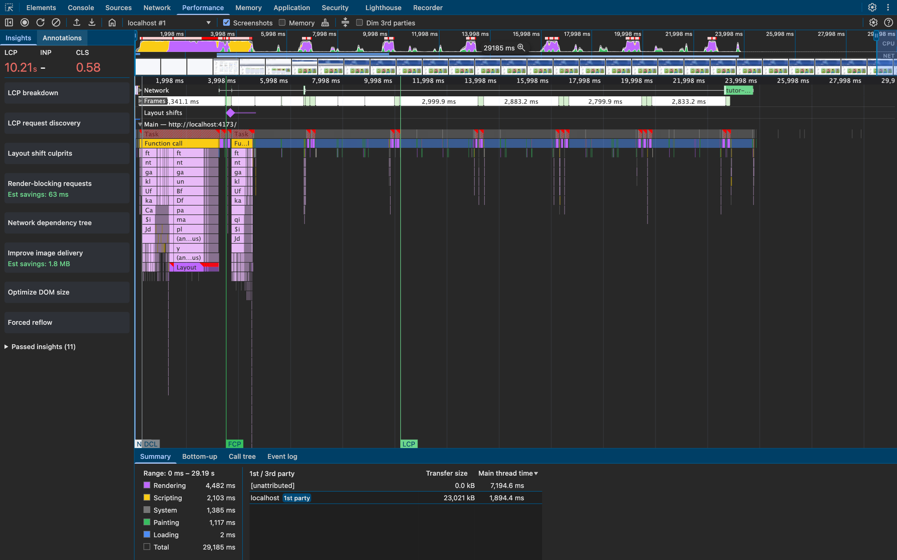
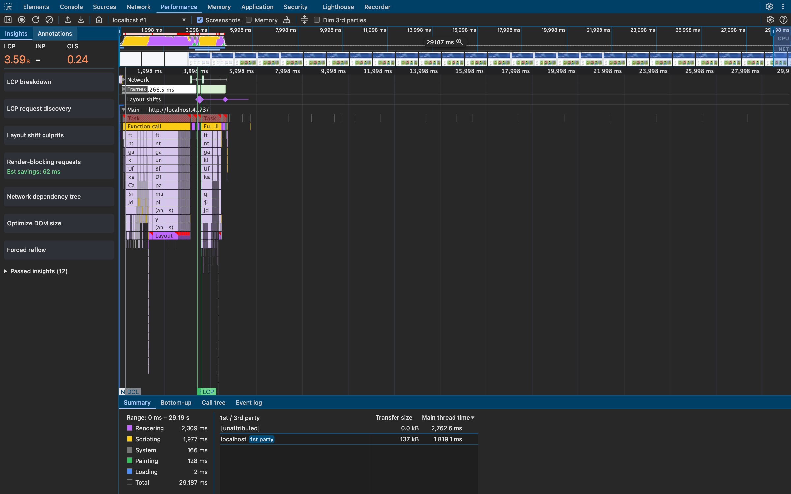
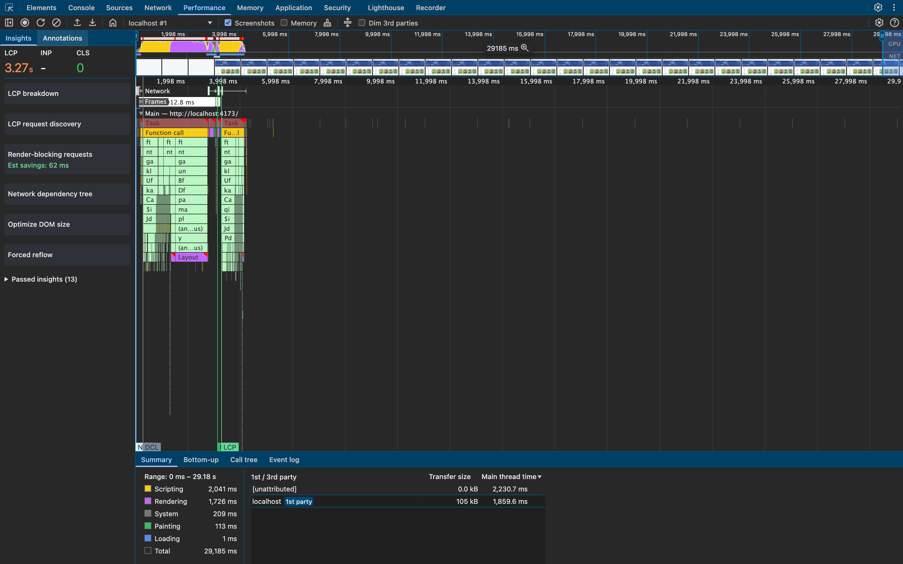
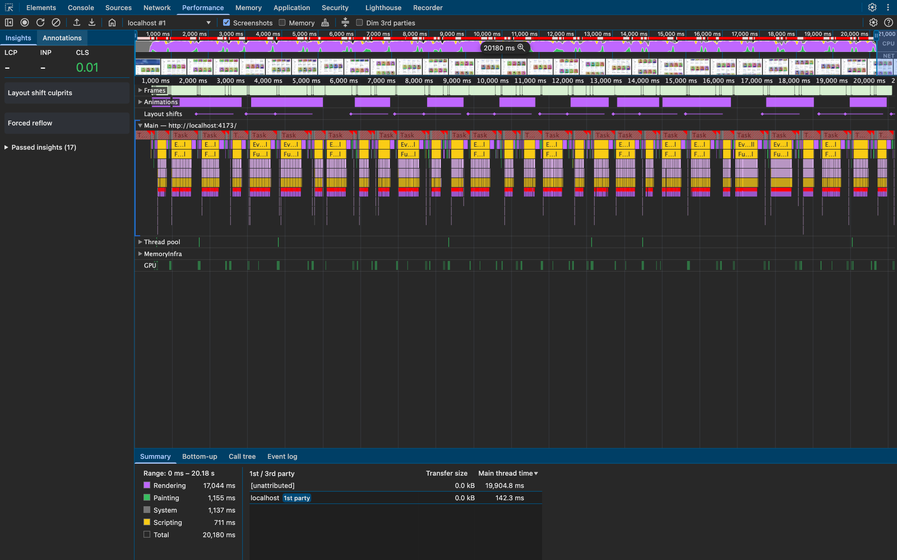
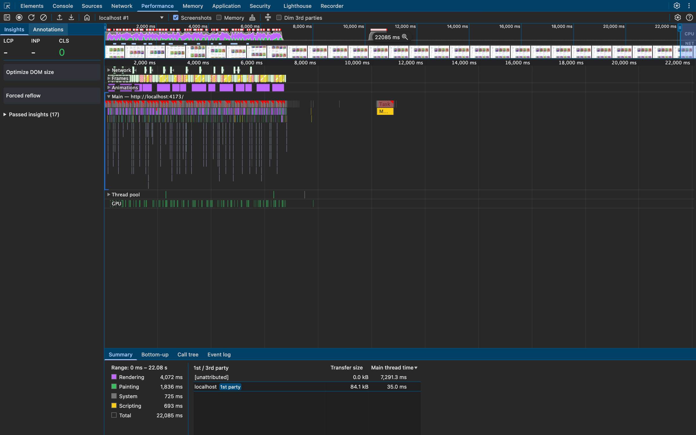
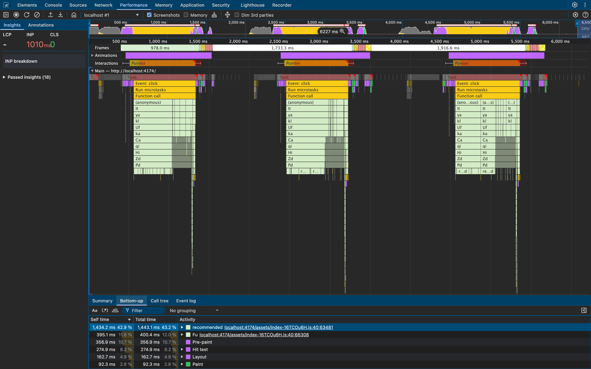
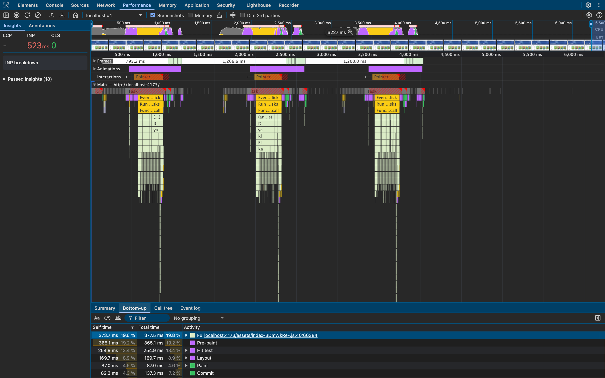
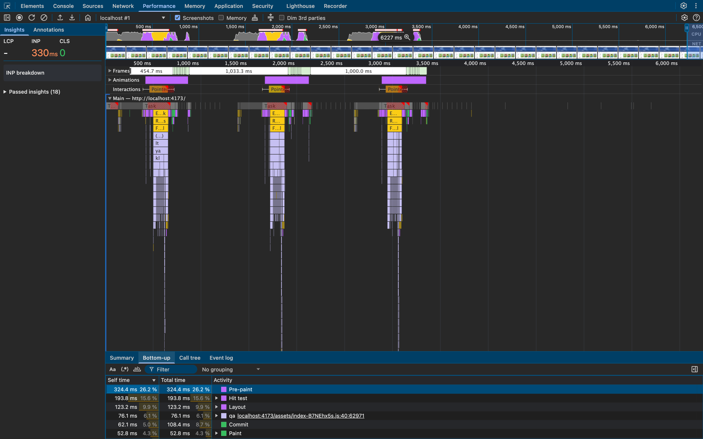
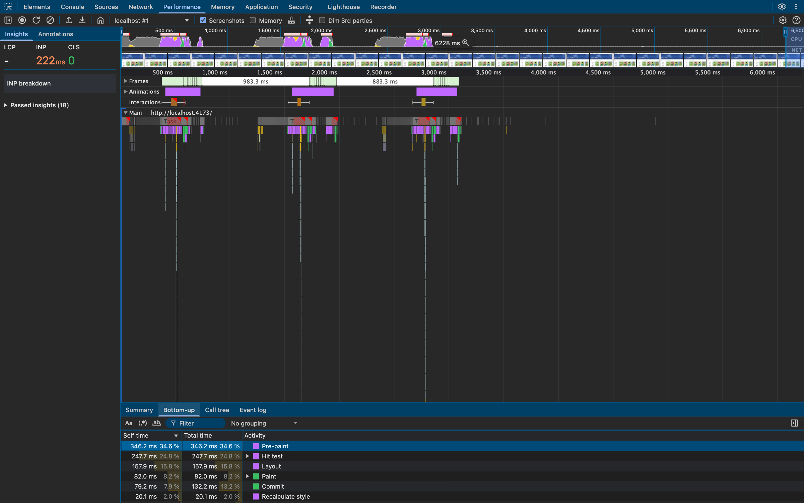

# Аудит продуктивності: «Каталог репетиторів»

Підсумок: шість виправлень, кожне окремим комітом і з вимірюванням до і після.
Між базовою лінією та фінальною версією:

| Метрика | Сценарій | До | Після | Зміна |
| --- | --- | ---: | ---: | ---: |
| LCP | завантаження | 9572 мс | 2288 мс | −76 % |
| CLS | завантаження | 0.581 | 0 | −100 % |
| Обсяг завантаженого | завантаження | 22 481 КБ | 103 КБ | −99.5 % |
| INP | клік «в обрані» | 872 мс | 192 мс | −78 % |
| INP | відкриття картки | 1312 мс | 288 мс | −78 % |
| INP | введення в пошук | 880 мс | 328 мс | −63 % |
| INP | зміна сортування | 264 мс | 96 мс | −64 % |
| Блокування кадрів | скрол | 9391 мс | 517 мс | −94 % |
| Forced reflow | скрол | 7041 мс | 0 мс | −100 % |

Функціональність не змінилась: пошук, фільтри, сортування, обрані й картка працюють як раніше.
`npm test` проходить: 4 тести, з них 3 нові regression-тести.

## Умови вимірювання

| Параметр | Значення |
| --- | --- |
| Машина | MacBook Pro, Apple M3 Pro, 36 GB RAM |
| Браузер | Google Chrome 157.0.8103.39, керований через puppeteer-core 25 |
| Режим | новий інкогніто-контекст (`createBrowserContext`) на кожен прогін: порожній кеш, без розширень |
| CPU throttling | 4× slowdown |
| Network throttling | власний профіль «Fast 4G»: 9 Mbps down, 1.5 Mbps up, RTT 60 мс |
| Вікно | 1440×900, devicePixelRatio 2 |
| Збірка | production: `npm run build` + `npm run preview` (http://localhost:4173) |
| Статистика | медіана з 3 прогонів; окремий 4-й прогін записує трейси (трейсинг додає накладні витрати, тому в цифри не входить) |

Скрипт вимірювання: [`perf/measure.mjs`](perf/measure.mjs), умови в [`perf/conditions.mjs`](perf/conditions.mjs).
Сирі дані кожного прогону лежать у `report/data/<крок>/runs.json`.

Щоб відтворити те саме вручну в DevTools:
1. Відкрити інкогніто-вікно.
2. Performance → ⚙ → CPU: 4× slowdown.
3. Network: Add custom profile 9000/1500 kbps, 60 ms.

### Сценарії

| Сценарій | Що робить |
| --- | --- |
| `load` | відкрити сторінку й дочекатися, поки мережа стихне |
| `search` | ввести «математика» по літері, 10 натискань з інтервалом 150 мс |
| `favorite` | натиснути ♡ на перших трьох картках |
| `details` | натиснути «Детальніше» на 4-й картці, потім Escape |
| `sort` | у полі «Сортування» ↓ (дешевші), потім ↑ (рекомендовані) |
| `scroll` | 30 прокруток колесом по 400 px з інтервалом 100 мс |

### Метрики

- **LCP, CLS**: `PerformanceObserver` (`largest-contentful-paint`, `layout-shift`). CLS рахується за вікнами сесій, як у Core Web Vitals.
- **INP**: найдовша взаємодія сценарію з Event Timing API (`event`, групування за `interactionId`). У сценарії менше 50 взаємодій, тому INP дорівнює максимуму.
- **Блокування кадрів**: сума `blockingDuration` записів Long Animation Frames (LoAF), аналог TBT для взаємодій.
- **Найдовший кадр**: максимальна тривалість LoAF.
- **Forced reflow**: сума `forcedStyleAndLayoutDuration` скриптів у LoAF. Це час примусового layout, коли JS читає геометрію після зміни DOM.
- **Обсяг**: сума `encodedDataLength` усіх відповідей (CDP `Network.loadingFinished`).

## Базова лінія

Початковий код (коміт `ec127d3`), медіана з 3 прогонів.

| Сценарій | LCP | CLS | Обсяг | Запити | INP | Блокування кадрів | Найдовший кадр | Forced reflow |
| --- | ---: | ---: | ---: | ---: | ---: | ---: | ---: | ---: |
| load | 9572 мс | 0.581 | 22 481 КБ | 41 | — | 4340 мс | 2562 мс | 1489 мс |
| search | | | | | 880 мс | 2650 мс | 852 мс | 74 мс |
| favorite | | | | | 872 мс | 2289 мс | 837 мс | 13 мс |
| details | | | | | 1312 мс | 2089 мс | 1271 мс | 475 мс |
| sort | | | | | 264 мс | 157 мс | 197 мс | 96 мс |
| scroll | | | | | — | 9391 мс | 509 мс | 7041 мс |

LCP-елемент — `hero.png`. DOM налічує 48 815 вузлів.

## Виправлення

Кожне виправлення переміряне в тих самих умовах. «До» означає стан після попереднього виправлення, а не базову лінію: так видно внесок кожної зміни окремо.

Трейси до і після мають однакову тривалість, а скріншоти показують увесь трейс. Тому масштаб на парі скріншотів однаковий.

Для перегляду: DevTools → Performance → Load profile → `report/traces/<крок>/<сценарій>.json.gz`.

### 1. Важкі зображення, що вантажаться всі одразу

Коміт [`c15fb2d`](../../commit/c15fb2d). Сценарій `load`.

| Метрика | До (`00-baseline`) | Після (`01-images`) |
| --- | ---: | ---: |
| Обсяг | 22 481 КБ | 134 КБ |
| Запити | 41 | 24 |
| LCP | 9572 мс | 3092 мс |

**Причина.** 36 фото репетиторів були PNG 900×900 по ~600 КБ, а на картці вони показуються шириною ~250 px. Hero був PNG 2400×900 на 1.3 МБ. Усі картинки вантажилися одразу, і hero, тобто LCP-елемент, ділив канал з 21 МБ фотографій. Інсайт DevTools «Improve image delivery» у трейсі оцінював економію в 1.8 МБ тільки на видимих картинках.

**Що змінено.**
- Фото стали WebP 512×512 (якість 75), hero має WebP 1200w і 2400w із `srcset`/`sizes`.
- Для hero стоїть `fetchpriority="high"`, фото карток отримали `loading="lazy"` і `decoding="async"`.
- Конвертація зроблена скриптом [`perf/optimize-images.mjs`](perf/optimize-images.mjs). Ілюстрації прості градієнти, тому візуально різниці немає.

| До | Після |
| --- | --- |
|  |  |

### 2. Зсуви макета від картинок без розмірів

Коміт [`300fba1`](../../commit/300fba1). Сценарій `load`.

| Метрика | До (`01-images`) | Після (`02-image-dimensions`) |
| --- | ---: | ---: |
| CLS | 0.284 | 0 |
| Обсяг | 134 КБ | 103 КБ |
| Запити | 24 | 15 |

**Причина.** У `` не було `width`/`height`, тож до завантаження файлу картинка мала висоту 0. Коли файл приходив, картка виростала і штовхала вниз увесь грід, а hero так само зсував увесь каталог.

Побічний ефект: lazy-картинки нульової висоти всі разом потрапляли у viewport, і браузер вантажив їх одразу. Звідси зайві запити.

**Що змінено.** Задано `width`/`height` для фото карток (512×512), hero (2400×900) і фото в картці деталей (112×112). CSS лишився `height: auto`, тож браузер резервує місце за пропорцією ще до завантаження.

| До | Після |
| --- | --- |
|  |  |

### 3. Forced reflow на кожен скрол у `useBioClamp`

Коміт [`e0ad4b5`](../../commit/e0ad4b5). Сценарій `scroll`.

| Метрика | До (`00-baseline`) | Після (`03-bio-clamp`) |
| --- | ---: | ---: |
| Forced reflow | 7041 мс | 0 мс |
| Блокування кадрів | 9391 мс | 471 мс |
| Найдовший кадр | 509 мс | 109 мс |

Як «до» взято базову лінію: виправлення 1–2 не чіпають JS під час скролу.

**Причина.** Хук висить на `scroll` і для кожної видимої картки робить послідовність `classList.remove('is-clamped')` → `offsetHeight` → `classList.add` → `offsetHeight`. Кожне читання геометрії після зміни класу змушує браузер синхронно перерахувати layout усієї сторінки з ~49 тис. вузлів. Це повторюється для кожної картки на кожну подію `scroll`, тобто класичний layout thrashing.

Інсайт DevTools «Forced reflow» показував 11.1 с у трейсі скролу. Усі виклики йдуть з обробника `Event: scroll`, а `scroll` у застосунку слухає тільки `useBioClamp`.

**Що змінено.**
- Переповнення визначається на вже обрізаному елементі як `scrollHeight > clientHeight`, без зняття класу.
- Спершу всі читання, потім усі `classList.toggle`: виходить один layout замість N.
- Скрол не змінює того, чи обрізаний текст, тому слухач `scroll` прибрано. Лишився `resize` через `requestAnimationFrame`.
- Кнопка «Читати далі» з'являється так само, але тепер для всіх карток, а не лише для тих, до яких догорнули.

| До | Після |
| --- | --- |
|  |  |

### 4. `tutorScore` у компараторі сортування

Коміт [`c64f785`](../../commit/c64f785). Сценарії `favorite`, `details`, `search`.

| Сценарій | INP до (`03-bio-clamp-interactions`) | INP після (`04-sort-scores`) |
| --- | ---: | ---: |
| favorite | 864 мс | 480 мс |
| details | 984 мс | 552 мс |
| search | 896 мс | 456 мс |
| sort | 112 мс | 88 мс |

Стан «до» переміряно окремо на коміті `e0ad4b5`: інтерактивні сценарії після виправлення 3 раніше не мірялись.

**Причина.** Компаратор `recommended` викликав `tutorScore` для обох елементів кожного порівняння. `tutorScore` проходить по всіх відгуках і парсить їхні дати через `new Date`. Сортування 2000 репетиторів робило 38 552 таких виклики замість 2000 (у Node без throttling це 149 мс). Сортування за замовчуванням якраз «Рекомендовані», а `getVisibleTutors` виконувався на кожен рендер `App`, тож клік по ♡ чи відкриття картки щоразу пересортовували весь каталог.

У Bottom-up трейсу кліку по ♡ першим рядком стоїть `recommended`: 1434 мс self time, 42.9 % часу.

**Що змінено.** `sortByScore` один раз рахує `Map` id → score і сортує за ним. Порядок не змінився, це перевіряє тест.

| До | Після |
| --- | --- |
|  |  |

### 5. Новий `Intl.NumberFormat` на кожну ціну

Коміт [`485e294`](../../commit/485e294). Сценарії `favorite`, `details`, `search`, `load`.

| Метрика | До (`04-sort-scores`) | Після (`05-price-format`) |
| --- | ---: | ---: |
| INP favorite | 480 мс | 304 мс |
| INP details | 552 мс | 360 мс |
| INP search | 456 мс | 344 мс |
| Найдовший кадр load | 2025 мс | 1683 мс |

**Причина.** `formatPrice` створював `new Intl.NumberFormat('uk-UA', …)` на кожен виклик. Конструктор шукає дані локалі й розбирає опції, а викликається він у кожній картці. Тож кожен рендер списку будував близько 2000 форматерів (35 мс у Node без throttling, ×4 у браузері).

**Що змінено.** Форматер створюється один раз на рівні модуля, `formatPrice` лише викликає `format`.

| До | Після |
| --- | --- |
|  |  |

### 6. Перерендер усіх 2000 карток на будь-яку зміну стану

Коміт [`94b7a02`](../../commit/94b7a02). Сценарії `favorite`, `details`.

| Метрика | До (`05-price-format`) | Після (`06-memo-cards`) |
| --- | ---: | ---: |
| INP favorite | 304 мс | 192 мс |
| INP details | 360 мс | 288 мс |
| Forced reflow favorite | 11 мс | 0 мс |
| Forced reflow details | 31 мс | 0 мс |

**Причина.** Будь-яка зміна стану `App` (♡, відкриття картки, літера в пошуку) перераховувала `getVisibleTutors` і рендерила всі 2000 `TutorCard`. `TutorList` передавав кожній картці нові стрілочні функції, тож навіть `React.memo` не допоміг би.

Новий масив `visible` на кожному рендері також перезапускав `useBioClamp`, який залежить від `[tutors]`.

**Що змінено.**
- `TutorCard` загорнуто в `React.memo`. Колбеки стабільні й приймають `tutor.id`: `onSelect={setSelectedId}`, `toggleFavorite` у `useCallback`.
- `visible` обчислюється в `useMemo` за `[query, filters, sortBy]`.
- Тепер клік по ♡ рендерить одну картку, а не 2000.

| До | Після |
| --- | --- |
|  |  |

## Regression-тести

| Тест | Що перевіряє | Початковий код | Після виправлення |
| --- | --- | --- | --- |
| [`catalog.sort.test.js`](src/__tests__/catalog.sort.test.js) | `tutorScore` викликається не більше разу на репетитора; порядок «Рекомендовані» не змінився | падає: `expected 7628 to be less than or equal to 500` | проходить |
| [`TutorList.rerender.test.jsx`](src/__tests__/TutorList.rerender.test.jsx) | після кліку ♡ рендериться не більше однієї картки (лічильник викликів `averageRating`, яку картка викликає раз на рендер); кнопка отримує `aria-pressed="true"` | падає: `expected 200 to be less than or equal to 1` | проходить |

Тести перевіряють поведінку (кількість рендерів і викликів дорогої функції), а не назви змінних.

Логи:
- [`report/regression-tests-on-initial-code.log`](report/regression-tests-on-initial-code.log): нові тести запущені на коді коміту `ec127d3`, обидва падають.
- [`report/regression-tests-after-fix.log`](report/regression-tests-after-fix.log): `npm test` після всіх виправлень, 4/4 проходять.

## Перевірено й свідомо не чіпали

Мікробенчмарк [`perf/micro.mjs`](perf/micro.mjs) (Node 26, без throttling, медіана з 7) і Bottom-up трейсів. У браузері з CPU 4× ці цифри приблизно вчетверо більші.

| Місце | Чому виглядає повільним | Скільки коштує насправді | Чому не проблема |
| --- | --- | ---: | --- |
| `suggestNames` / `editDistance` (`utils/suggest.js`) | матриця O(n·m) на кожне слово | 2.6 мс | викликається лише на порожньому результаті, по ~60 унікальних словах |
| `buildSubjectOptions` + `slugify` (`utils/subjectOptions.js`) | ланцюжок map/map/filter/sort/reduce/map і регулярки | 0.16 мс | 12 предметів |
| `api/reference.js`: три послідовні `await` | схоже на мережевий водоспад | 0.001 мс | дані локальні, це мікрозадачі, а кеш у `Map` |
| `applyFilters` (`utils/catalog.js`) | `some` + `includes` на кожного з 2000 | 0.02 мс | лінійний прохід по малих масивах |
| `counts` у `Filters.jsx` | `reduce` по 2000 репетиторах на кожен рендер | < 0.2 мс | разом з `buildSubjectOptions` |
| `matchesQuery` / `normalizeText` (`utils/text.js`) | `normalize('NFD')` і регулярки по біо кожного репетитора на кожну літеру | 5.4 мс на 2000 | ~20 мс з throttling, менше межі long task 50 мс; у фінальному трейсі пошуку не домінує |
| `generateTutors` (`data/tutors.js`) | генерація 2000 об'єктів із відгуками | 18.8 мс | один раз при старті; це заглушка замість API, не код застосунку |
| `TutorDetails`: сортування відгуків | `sort` + `localeCompare` | < 0.1 мс | ≤ 36 відгуків одного репетитора |

**Що лишилось.** Перший рендер 2000 карток (48 815 DOM-вузлів) — один кадр ~1.7–1.9 с під CPU 4×. Наступний крок тут віртуалізація списку або поступовий рендер. Це змінює поведінку прокрутки й пошуку по сторінці (Ctrl+F), тому в рамках лабораторної не робилось.

## Як відтворити

```bash
npm install
npm run build && npm run preview          # http://localhost:4173

cd perf && npm install
node measure.mjs --label my-run --runs 3 --trace   # цифри + трейси в report/
node screenshot.mjs --label my-run --only favorite --tab bottom-up
cd .. && ./node_modules/.bin/vite-node perf/micro.mjs
```
